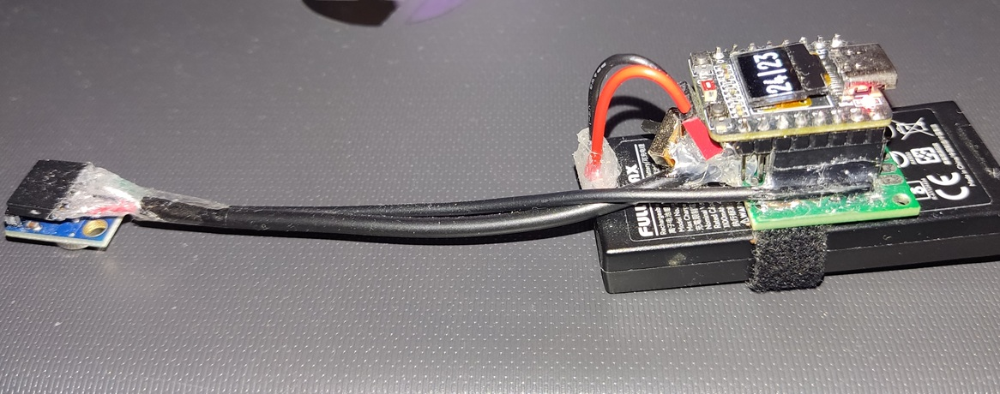
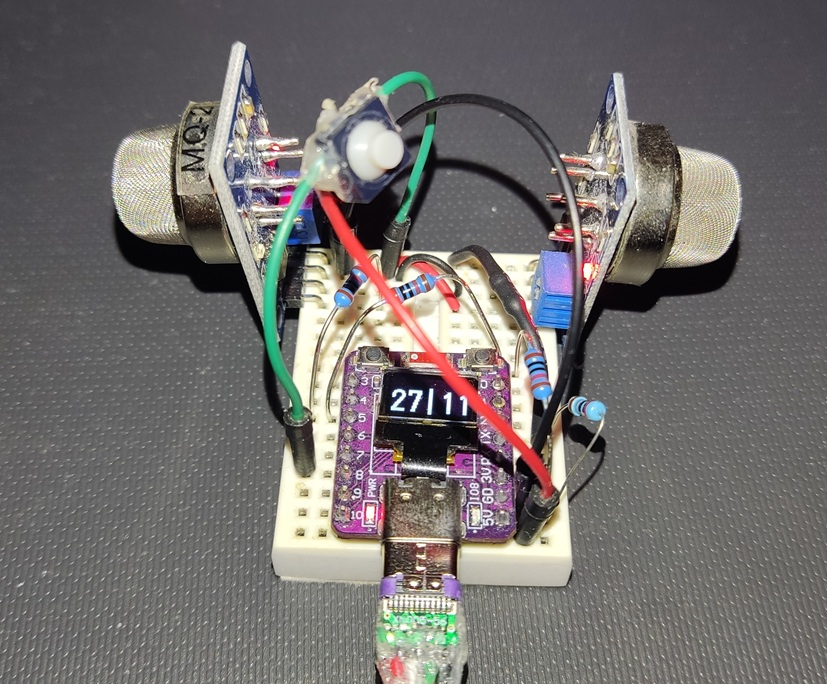

# Test ESP32

Testing ESP32 capabilities
 - Wireless: ESP-NOW, WiFi, HC12, hotspot, web server
 - Sensors: BME680, microphones (INMP441, ICS-43434), MLX90614 (infrared thermometer), MQ sensors (gas sensors), SCD41 (CO2 sensor)
 - Different ESP32 variants (C3, S3...)
 - Measuring current consumption

## Projects

### Contactless temperature reading - MLX90614, ESP32-C3 w/ OLED

Measures temperature of objects (e.g. cup of coffee) using MLX90614 infrared thermometer, displays readings on an OLED screen.

### Smoke sensor(s) - MQ2, MQ135, ESP32-C3 w/ OLED

Detects smoke and air quality using MQ2 and MQ135 sensors, displays readings on an OLED screen. Button click changes modes: current values, MQ2 graph, MQ135 graph.
